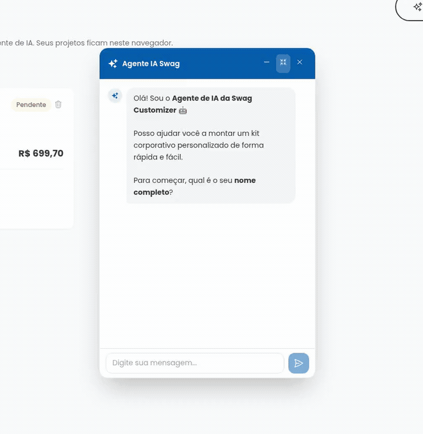
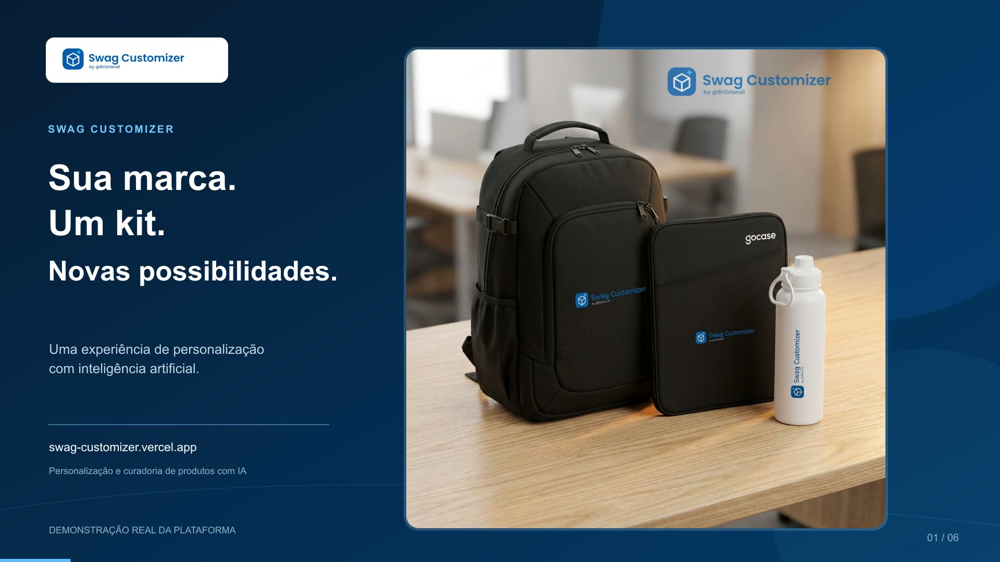
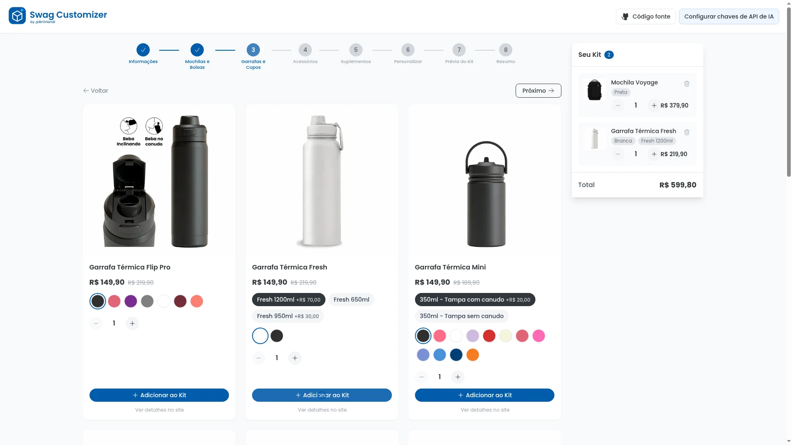
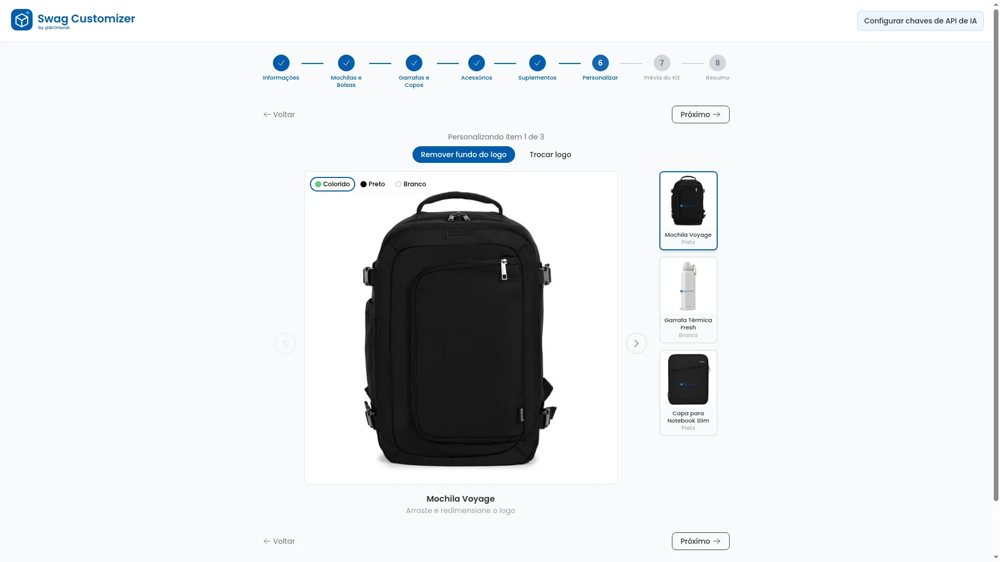
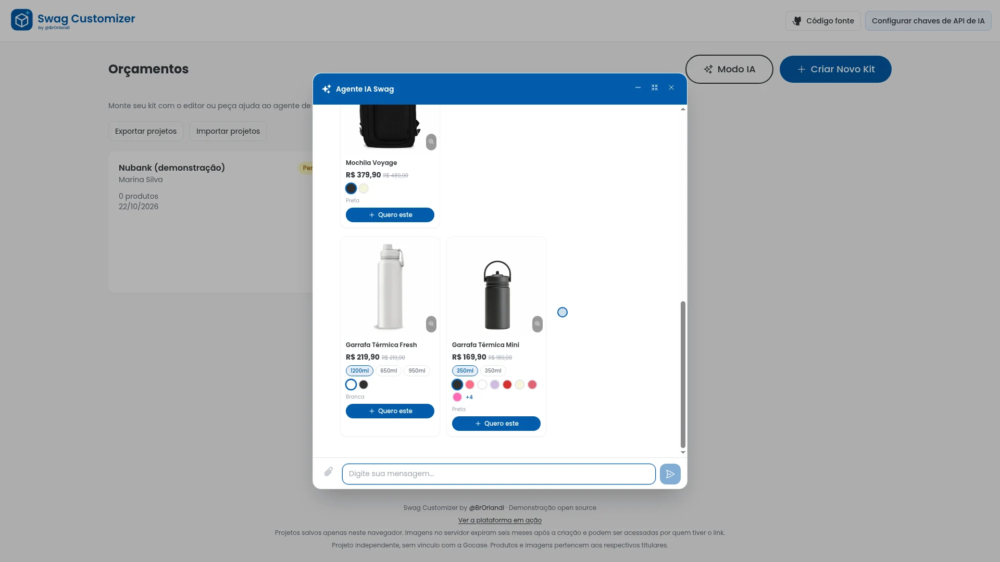
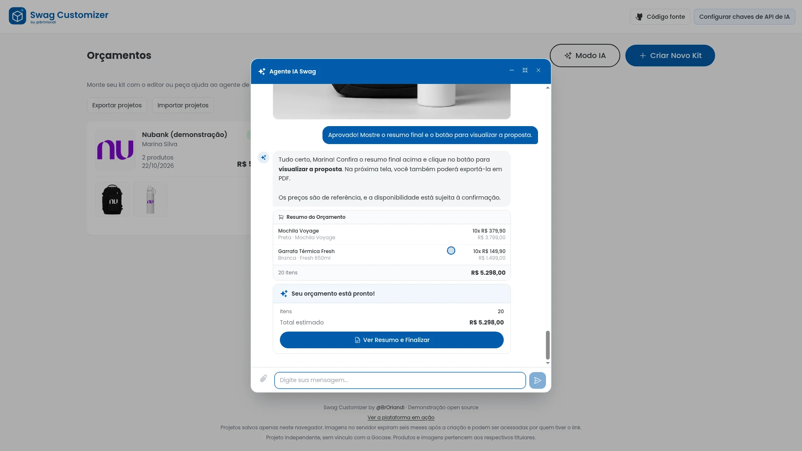
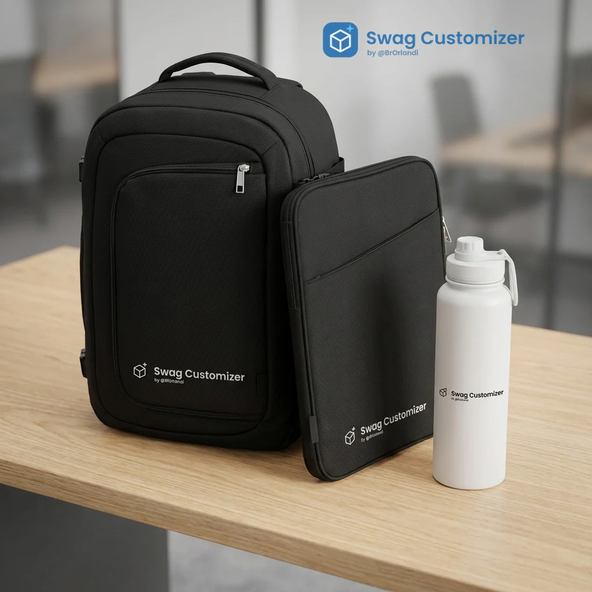
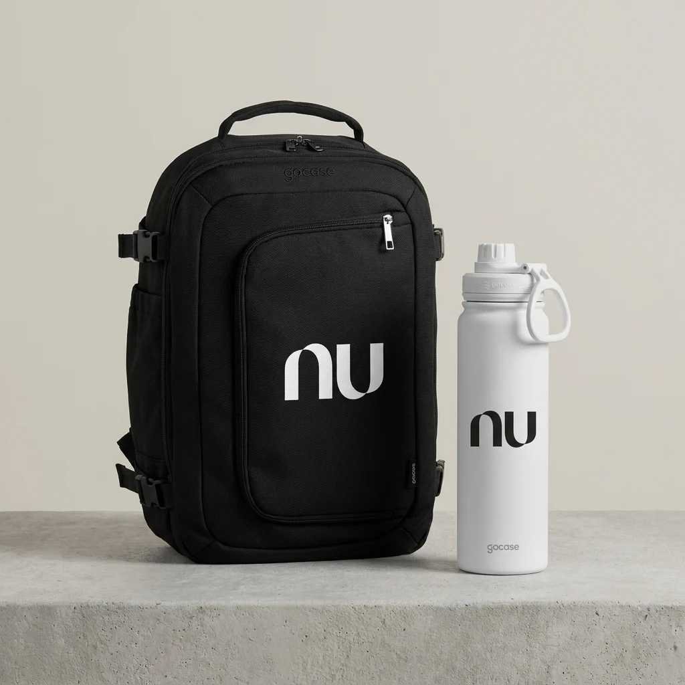

# Swag Customizer

[](https://swag-customizer.vercel.app/app/)

<p align="center"></p>

Uma demonstração open source de como integrar IA à experiência de personalização de produtos e à escolha de kits corporativos.

Criado originalmente como projeto de candidatura a uma vaga na Gocase, este projeto foi adaptado para funcionar sem login, banco de dados ou conta compartilhada de IA. A marca Swag Customizer é fictícia e o projeto é independente, sem vínculo ou endosso da Gocase.

## Veja a plataforma em ação

[**Abrir a galeria e assistir aos três vídeos**](https://swag-customizer.vercel.app/)

[](https://swag-customizer.vercel.app/)

| Vídeo | O que mostra |
| --- | --- |
| [Montando um kit Swag Customizer](https://swag-customizer.vercel.app/media/videos/01-kit-swag.mp4) | Produtos, aplicação do logo, editor visual, prévia com IA e resumo. |
| [Montando um kit pelo chat — exemplo Nubank](https://swag-customizer.vercel.app/media/videos/02-chat-nubank.mp4) | Sugestões do catálogo, dúvidas, quantidades, envio do logo, mockups e proposta. |
| [Apresentação com motion graphics](https://swag-customizer.vercel.app/media/videos/03-apresentacao-motion.mp4) | Os dois fluxos apresentados com animações e capturas reais da plataforma. |

As gravações usam respostas reais do agente e imagens geradas com Gemini. As esperas de processamento foram reduzidas na edição. As chaves foram configuradas antes das gravações e não aparecem no material. O exemplo Nubank é demonstrativo e independente, sem vínculo ou endosso da marca.

| Monte seu kit | Personalize os produtos |
| --- | --- |
|  |  |
| **Receba sugestões do agente** | **Confira o orçamento na conversa** |
|  |  |
| **Kit Swag Customizer gerado com IA** | **Exemplo Nubank gerado com IA** |
|  |  |

Detalhes das capturas e da renderização: [docs/DEMO.md](docs/DEMO.md).

## Duas experiências de IA

- **Personalização com IA:** aplique sua marca em produtos, edite mockups visualmente e gere uma composição do kit usando OpenAI ou Google Gemini.
- **Agente de compras:** converse para encontrar produtos, esclarecer dúvidas usando o catálogo e montar um orçamento. As ferramentas do agente mostram cards, atualizam itens e geram mockups reais.

O editor manual usa Fabric.js e a remoção de fundo roda no navegador. O catálogo demonstrativo contém 24 produtos com variantes, imagens e preços de referência; não há compra, estoque atualizado ou integração comercial.

## Experimentar

Apresentação: https://swag-customizer.vercel.app/

Plataforma: https://swag-customizer.vercel.app/app/

1. Crie um kit e selecione os produtos.
2. Envie um logo PNG/JPEG/WebP e personalize os mockups.
3. Para conversar com o agente ou gerar imagens, use **Configurar chaves de API de IA** no topo.
4. Informe sua chave OpenAI (agente e imagens) e/ou Google Gemini (imagens). O uso é cobrado pelo respectivo provedor e depende do acesso ao modelo.
5. Finalize o projeto, exporte PDF ou faça backup dos dados pelo botão **Exportar projetos**.

As chaves ficam no localStorage deste navegador e são restauradas ao recarregar a página. Use **Apagar chaves** no painel para removê-las. São enviadas por HTTPS ao backend em cada processamento; o servidor não as grava em arquivos ou logs, e os backups de projetos não incluem chaves.

## Provedor e modelo do agente

## Dados e arquivos

| Conteúdo | Onde fica | Prazo |
| --- | --- | --- |
| Projetos, orçamentos e itens | localStorage deste navegador | Até limpar os dados do site |
| Chaves pessoais e modelos de IA | localStorage deste navegador | Até apagar as chaves ou limpar os dados do site |
| Conversa com o agente | localStorage deste navegador | Até encerrar/limpar a conversa |
| Chaves pessoais de IA | Memória da página e do pedido no backend | Apenas durante o uso/processamento |
| Logos, mockups e imagens geradas | Volume de arquivos do backend Docker | Seis meses desde a criação do arquivo |

Sem login, cada navegador tem seus próprios projetos. O backend recebe o histórico e um snapshot do projeto a cada conversa, processa e devolve o estado atualizado; não guarda projetos ou sessões de usuário. Os arquivos usam UUIDs aleatórios e qualquer pessoa com a URL pode acessá-los até a expiração. Um arquivo vencido é bloqueado imediatamente na leitura; a limpeza física roda na inicialização e a cada hora.

O backup JSON contém os dados e as URLs das imagens, não as imagens nem as chaves. Baixe imagens importantes antes da expiração. Links de projetos só funcionam no navegador que tem os dados; para outro navegador, exporte e importe o backup. Limpar dados do site ou usar navegação anônima pode apagar seus projetos.

## Desenvolvimento local

Requisitos: Node.js 24 e npm.

```bash
npm ci
cp .env.example .env
npm run dev
```

Abra http://localhost:3000. O frontend e o backend rodam juntos localmente. Para usar suas chaves locais do `.env`, defina `NUXT_ALLOW_ENV_KEYS=true` e preencha `NUXT_OPENAI_API_KEY`/`NUXT_GEMINI_API_KEY`. Esse fallback é desativado em produção, mesmo se a variável estiver ligada.

```bash
npm test
npm run typecheck
npm run build       # Nuxt completo para o backend Docker
npm run generate    # frontend estático para a Vercel
```

## Configuração

Veja [.env.example](.env.example). Todas as variáveis abaixo são de runtime do backend, exceto `NUXT_PUBLIC_API_BASE`, definida no build do frontend.

| Variável | Uso |
| --- | --- |
| `NUXT_PUBLIC_API_BASE` | URL HTTPS do backend no build do frontend; vazio para desenvolvimento integrado |
| `NUXT_PUBLIC_URL` | URL HTTPS pública do backend, usada nas URLs de arquivos |
| `NUXT_ALLOWED_ORIGINS` | Origens do frontend permitidas, separadas por vírgula; sem `*` |
| `NUXT_STORAGE_DIR` | Diretório persistente dos arquivos, `/data/files` no Docker |
| `NUXT_STORAGE_MAX_BYTES` | Limite total do armazenamento, padrão 10 GiB |
| `NUXT_OPENAI_CHAT_MODEL` | Modelo do agente; padrão `gpt-4o` |
| `NUXT_OPENAI_IMAGE_MODEL` | Modelo de imagem OpenAI; padrão `gpt-image-1.5` |
| `NUXT_GEMINI_IMAGE_MODEL` | Modelo de imagem Gemini; padrão `gemini-3-pro-image` |
| `NUXT_RESEND_API_KEY` | Opcional: credencial Resend de quem hospeda o backend |
| `NUXT_EMAIL_FROM` | Opcional: remetente validado no Resend |

Sem as duas variáveis de e-mail, nenhum e-mail é enviado. A proposta continua sendo finalizada e exportada em PDF. Os modelos podem exigir faturamento, verificação da organização ou permissões específicas; os identificadores são configuráveis para acompanhar a disponibilidade dos provedores.

## Deploy

- **Frontend:** Vercel, build `npm run generate:site`, saída `.output/site`. A apresentação fica em `/` e a aplicação em `/app/`. Configure `NUXT_PUBLIC_API_BASE` com a URL do backend. `vercel.json` oferece fallback SPA para acesso direto às rotas de `/app`, mantendo mídias e apresentação como arquivos estáticos. O backend Docker mantém suas rotas `/api` na raiz.
- **Backend:** Docker/Dokploy com `docker-compose.yml`. Conecte a rede externa `dokploy-network`, configure um domínio HTTPS para o serviço `backend` na porta 3000 e preserve o volume `files`.
- Não configure chaves OpenAI/Gemini do proprietário no deploy público. Os visitantes fornecem as próprias.
- No Dokploy, mantenha logs de corpo/headers desligados. Nunca registre `x-openai-key` ou `x-gemini-key` no proxy.
- Verificação de saúde: `GET /api/health`.

Para Docker fora do Dokploy, adapte a rede do compose e publique a porta 3000 localmente. A imagem executa como usuário sem privilégios. O serviço limita tamanho dos pedidos, tamanho de imagem (10 MiB), resolução decodificada, espaço em disco, frequência de POSTs e processamentos simultâneos. Os limites são por instância; este projeto pressupõe um único backend com volume local.

## Estrutura

- `pages/`, `components/`, `composables/`: aplicação Vue e persistência local.
- `server/api/`: processamento de IA, upload/leitura de arquivos e e-mail opcional.
- `server/utils/ai-chat/`: loop do agente e ferramentas sobre o snapshot recebido.
- `server/utils/file-store.ts`: arquivos, metadados de expiração e limpeza, sem banco.
- `public/data/products.json`: catálogo usado pelo frontend.
- `public/images/products/`: imagens demonstrativas locais.
- `server/assets/`: catálogo e imagens disponíveis para ferramentas no backend.
- `docs/catalog-sources.json`: URLs de origem dos assets do catálogo.

## Licença e créditos

Código sob [MIT](LICENSE). O logo Swag Customizer foi criado para esta demonstração. Nomes, fotografias, marcas e conteúdo dos produtos de terceiros permanecem pertencendo aos respectivos titulares e não são licenciados sob MIT. Veja [THIRD_PARTY_ASSETS.md](THIRD_PARTY_ASSETS.md).

Por [@BrOrlandi](https://github.com/BrOrlandi).
